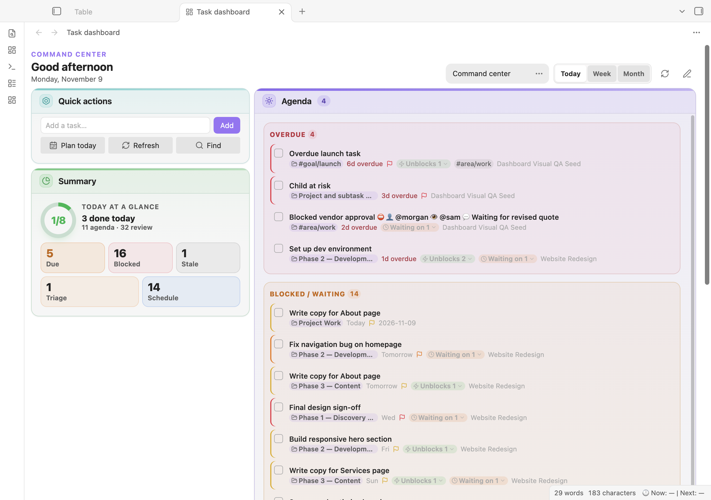

# Task Manager for Obsidian

Manage tasks across your Obsidian vault while keeping them in your Markdown files. Find tasks with queries, plan with dashboards and calendars, and add reminders or integrations when you need them.

> Task Manager is pre-release. See [Installation](docs/INSTALLATION.md) for manual installation and compatibility information.



[More screenshots](docs/screenshots/README.md) · [Getting started](docs/tutorials/GETTING_STARTED.md) · [Documentation](docs/INDEX.md)

## Quick start

After [installing the plugin](docs/INSTALLATION.md), add a task to a note:

```markdown
- [ ] Plan the trip
```

Add a query block to show unfinished tasks:

````markdown
```task-list
not done
sort by smart
```
````

Run **Task Manager: Open dashboard** from the command palette to see your tasks and planning widgets. For a guided introduction, run **Open getting started**.

## Features

- Create and edit tasks with configurable statuses, dates, priorities, recurrence, and dependencies.
- Find and organize tasks with [queries](docs/tutorials/QUERY_LANGUAGE.md), saved views, and list, table, Kanban, calendar, or timeline layouts.
- Plan with the sidebar, dashboard, daily planner, and project workspaces. Customize the dashboard with [widgets](docs/DASHBOARD_WIDGETS.md).
- Set reminders and optionally log completed tasks to daily notes. Reminders require Obsidian to be running; mobile operating systems can suspend the app.
- Connect optional services such as Todoist, CalDAV, Google Tasks, Microsoft To Do, and Apple Reminders. Read [Privacy](docs/PRIVACY.md) and back up your vault before configuring sync.

Task Manager reads common Obsidian Tasks-style markers and compatible `tasks` blocks, but its query language and behavior are not identical to the Tasks plugin. See [Compatibility](docs/COMPATIBILITY.md) before migrating queries.

## Documentation

- [Installation](docs/INSTALLATION.md) and [getting started](docs/tutorials/GETTING_STARTED.md)
- [Query language](docs/tutorials/QUERY_LANGUAGE.md) and [settings](docs/SETTINGS.md)
- [Command reference](docs/COMMANDS.md)
- [Integration guides and full index](docs/INDEX.md)
- [Troubleshooting](docs/TROUBLESHOOTING.md)
- [Mobile](docs/mobile.md), [reminders](docs/reminder-integration.md), and [platform support](docs/PLATFORM_SUPPORT.md)
- [Runtime API](docs/API.md) and [desktop MCP companion](docs/MCP.md)

## License

[MIT](LICENSE)
