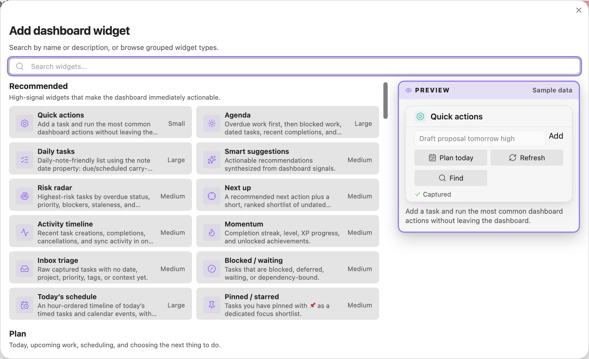

# Dashboard widgets

The **Dashboard** is an interactive, drag-and-drop command center for your tasks. It is
separate from the static `Task Command Center.md` note — the dashboard is a live view whose
widgets recompute from your vault every time it refreshes.

This guide covers how to use the dashboard and documents every widget (**86** in total).

---

## Opening the dashboard

- Click the **layout-dashboard** ribbon icon (_"Open Task Manager dashboard"_), **or**
- Run the command **Task Manager: Open dashboard** from the command palette.

## Widget picker preview



The picker preview uses sample data; it does not add a task.

## Arranging widgets

- **Add** a widget with the **＋ / Add widget** button. The picker groups widgets into
  *Recommended, Plan, Decide, Monitor, Review & reflect, Collaborate,* and *Integrations*,
  with live previews. Template selection also shows compact layout silhouettes so you can compare
  each dashboard's visual rhythm before creating it.
- **Resize** a widget by cycling its size (small → medium → large); each size renders more rows.
- **Drag** widgets to rearrange them on the snap grid, and drag any edge/corner to **resize**.
  The grid is very fine-grained (96 columns with short rows), so widgets snap in small increments
  (roughly 12–14px steps) for precise sizing; hold and drag slowly to fine-tune. Built-in templates
  are authored on a coarser 12-column grid and scaled up, so their proportions are unchanged.
- **Remove** a widget from its card menu.
- Some widgets expose a small **config** (gear) surface — e.g. *Custom field breakdown*,
  *Goals & objectives* (see [Configurable widgets](#configurable-widgets)).

A fresh install seeds a curated command-center layout for general task operations: quick capture,
a compact **Today summary** card with review queue counts, and a prominent **Agenda** work surface
that starts with overdue and blocked/waiting work, then tasks due today, tomorrow, recently
completed tasks (collapsed by default), and the remaining backlog. The time-blocked **Planning studio** template is a better fit
when you specifically want schedule/capacity planning.
Your layout is saved per vault. Dashboards created from a built-in template that you have **not**
modified are refreshed automatically when the template's design is updated; once you move, resize,
add, or remove a widget the layout is considered customized and is never changed for you.

---

## Embedding widgets in notes

You don't have to open the full dashboard view — you can drop a **live widget** or an **entire
dashboard** into any regular note using a fenced code block. They render with the same data and
refresh as your tasks change.

### A single widget

Use a ` ```task-manager-widget ` block with simple `key: value` lines:

````markdown
```task-manager-widget
type: agenda
title: Today's agenda
size: large
```
````

Supported keys:

| Key | Required | Notes |
| --- | --- | --- |
| `type` | **yes** | Any widget type from the [catalog](#widget-catalog), e.g. `agenda`, `overdue-risk`, `focus-queue`, `stats`. |
| `title` | no | Heading shown above the widget (defaults to the widget's name). |
| `size` | no | `small`, `medium`, or `large` (controls how many rows/how much detail render). |
| `presentation` | no | `standard`, `kpi`, or `hero` for the stat-style widgets. |
| `query` | no | For query-backed widgets (e.g. `saved-query`) — the same syntax as a saved view. |
| `showCompleted` | no | `true`/`false` for list widgets. |

You can also pass full JSON instead of `key: value` lines — `{ "widget": { "type": "agenda", ... } }`.

For daily notes, use the low-chrome daily task widget. It reads the containing note's `date`
frontmatter property by default:

````markdown
---
date: 2026-06-21
---

```task-manager-widget
type: daily-todos
title: Tasks
```
````

`daily-todos` shows active tasks due on or before the note date, active tasks scheduled on or
before the note date, plus tasks completed or cancelled on that exact date. Use `dateProperty: day`
if your daily notes use a different property name, or `date: 2026-06-21` to pin the widget to an
explicit date.

### A whole dashboard

Use a ` ```task-manager-dashboard ` block containing an exported layout. The easiest way to get one:
open the dashboard, use **⋯ → Export** (or the **Save dashboard as note** command, which scaffolds
the whole note for you), then paste the exported JSON between the fences. The following is a schematic, not a complete layout:

````markdown
```task-manager-dashboard
{ "kind": "task-manager-dashboard-layout", "layout": { ... } }
```
````

The **Save dashboard as note** command writes this for you automatically, including front-matter so
the note is easy to find and link.

---

## Settings that power widgets

These live in **Settings → Task Manager** (Dashboard section):

| Setting | Default | Used by |
| --- | --- | --- |
| **Daily focus capacity (minutes)** | `360` | Capacity planner, Schedule conflicts |
| **Daily goal** (tasks/day) | `5` | Daily goal, Goal streak |
| **Goal tag prefix** | `goal` | Goals & objectives (matches `#goal/<name>`) |
| **Area tag prefix** | `area` | Areas of responsibility (matches `#area/<name>`) |

*Today's schedule* and *Schedule conflicts* primarily use task date/time metadata. Their renderer can consume an already supplied/cached calendar-event array, but production arbitrary remote ICS URL fetching is disabled and obsolete URL controls do not establish a supported feed. A legacy cache may remain until cleared; no new remote overlay is fetched. CalDAV VTODO task sync is a separate integration and is not described as a Dashboard event overlay.

---

## Configurable widgets

- **Goals & objectives** — set a **Goal field key** in the widget's config to roll tasks up by a
  custom inline field (default `goal`, i.e. `[goal:: Launch v2]`). `#goal/<name>` tags are always
  included. Change the tag prefix globally via *Goal tag prefix*.
- **Areas of responsibility** — groups by an `#area/<name>` tag (prefix configurable via *Area tag
  prefix*) or, if untagged, the note's **top-level folder**.
- **Custom field breakdown** — choose any custom field key, or leave blank to auto-pick the
  most-populated one.

### Defining goals & areas

```markdown
- [ ] Draft launch plan #goal/launch-v2 📅 2026-07-01
- [ ] Book venue [goal:: Offsite] 
- [ ] Pay quarterly taxes #area/finance
```

- *Goals & objectives* shows **done / total** progress per goal and flags goals whose earliest
  open due date is in the past.
- *Areas of responsibility* shows **active** (and overdue) task load per area.

---

## Widget catalog

> Widgets without the required data show an empty state.

## Recommended
_High-signal widgets that make the dashboard immediately actionable._

| Widget | What it shows |
| --- | --- |
| **Smart suggestions** | Actionable recommendations synthesized from dashboard signals. |
| **Agenda** | Scope-aware work surface: overdue work, blocked/waiting tasks, tasks due today/tomorrow, collapsed recently done, and backlog. |
| **Today summary** | Scoped completion, done count, agenda/due/overdue counts, and review queue totals for triage, scheduling, blocked, and stale work. |
| **Daily tasks** | Low-chrome daily-note embed: due/scheduled carry-forward for the note date plus tasks completed/cancelled that day. |
| **Risk radar** | Highest-risk tasks by overdue status, priority, blockers, staleness, and dependencies. |
| **Next up** | A recommended next action plus a short, ranked shortlist of undated work. |
| **Quick actions** | Shortcut buttons for common Task Manager commands and maintenance actions. The button grid reflows to best fit the widget's size — more columns when it's wide, fewer (taller) rows when it's narrow, and stacked icon-over-label (or icon-only) buttons when cells get small. |
| **Activity timeline** | Recent task creations, completions, cancellations, and sync activity in one feed. |
| **Quick capture** | Add a task to your inbox without leaving the dashboard. |
| **Momentum** | Completion streak, level, XP progress, and unlocked achievements. |
| **Inbox triage** | Unplanned captured tasks missing dates, project, priority, and tags. |
| **Blocked / waiting** | Tasks that are blocked, deferred, waiting, or dependency-bound. |
| **Today's schedule** | An hour-ordered timeline of today's timed tasks and calendar events, with untimed work listed below. |
| **Pinned / starred** | Tasks marked as pinned, such as with the `📌` task syntax or `[pinned:: true]`, as a dedicated focus shortlist. |

## Plan
_Today, upcoming work, scheduling, and choosing the next thing to do._

| Widget | What it shows |
| --- | --- |
| **Agenda** | Scope-aware work surface: overdue work, blocked/waiting tasks, tasks due today/tomorrow, collapsed recently done, and backlog. |
| **Daily tasks** | Low-chrome daily-note embed: due/scheduled carry-forward for the note date plus tasks completed/cancelled that day. |
| **Dated agenda** | Overdue, due, scheduled, or starting tasks for the selected scope, grouped into Overdue / Today / Upcoming. |
| **Upcoming** | The next seven days, grouped by day. |
| **Today's schedule** | An hour-ordered timeline of today's timed tasks and calendar events, with untimed work listed below. |
| **Deadline strip** | A compact 14-day pressure strip showing task count and estimated effort by date. |
| **Calendar** | A compact month calendar of upcoming work. |
| **Next up** | A recommended next action plus a short, ranked shortlist of undated work. |
| **Next action per project** | The single best available next action for each active project — your GTD engagement list. |
| **Pinned / starred** | Tasks marked as pinned, such as with the `📌` task syntax or `[pinned:: true]`, as a dedicated focus shortlist. |
| **Quick wins** | Unblocked tasks estimated at 30 minutes or less. |
| **Deep work** | Important unblocked tasks that likely need a longer focus block. |
| **Daily goal** | Progress toward your daily task-completion target. |
| **Daily note** | Tasks in today's daily note, with a shortcut to open it. |
| **Quick capture** | Add a task to your inbox without leaving the dashboard. |
| **Time block suggestions** | Simple suggestions for filling today with deep work, quick wins, and review. |
| **Capacity planner** | Committed estimated effort vs. your available focus capacity for each of the next 7 days. |
| **Schedule conflicts** | Overlapping timed items today plus upcoming days where committed effort exceeds capacity. |

## Decide
_Prioritization, triage, quality checks, and work classification._

| Widget | What it shows |
| --- | --- |
| **Eisenhower matrix** | Urgent/important quadrants for deciding what to do, schedule, delegate, or drop. |
| **Inbox triage** | Unplanned captured tasks missing dates, project, priority, and tags. |
| **Needs scheduling** | Clarified, actionable tasks that have no date yet — give them a when. |
| **Status distribution** | Vault tasks grouped by configured workflow status. |
| **Priority distribution** | Active tasks by priority, highlighting urgent concentration. |
| **Custom field breakdown** | Top values for a chosen custom task field, automatically selecting the most-used field by default. |
| **Due date quality** | Tasks with missing, inconsistent, or low-quality date metadata. |
| **Metadata completeness** | How much of your active task metadata is filled in. |
| **Energy fit** | Available tasks grouped by low, medium, and high energy fit. |
| **Someday / maybe** | Parked, low-priority, backlog, or far-future tasks. |
| **Custom query** | Render any Task Manager query as a list. |
| **Saved views** | Launch any saved query and preview its matching tasks inline. |
| **Tag explorer** | Browse your most-used tags and contexts; click one to preview its tasks. |

## Monitor
_Project load, risk, dependencies, backlog, and stale work._

| Widget | What it shows |
| --- | --- |
| **Risk radar** | Highest-risk tasks by overdue status, priority, blockers, staleness, and dependencies. |
| **Project health** | Projects ranked by overdue, blocked, stale, and missing-next-action signals. |
| **Goals & objectives** | Completion progress for goals defined via `#goal/<name>` tags or a `[goal:: ...]` field, with target dates. |
| **Areas of responsibility** | Active workload grouped by life/work area: an `#area/<name>` tag or the top-level folder. |
| **Milestone progress** | Completion progress grouped by project, tag, folder, or task heading. |
| **Assignee workload** | Active task load grouped by assignee, reviewer, team, or unassigned work. |
| **Workload by project** | Active task load and risk grouped by project, tag, or folder. |
| **Stale tasks** | Active tasks that appear old, unscheduled, or deferred too long. |
| **Task age distribution** | Open tasks bucketed by how long they have been in your system. |
| **Time in status** | Approximate average and oldest age of active work in each current status. |
| **Dependencies** | Tasks that block other tasks, plus unresolved dependency references. |
| **Subtask progress** | Parent tasks with a completion bar across their child tasks, linked by id / parentId. |
| **Cycle time** | Average lead/cycle time and the oldest work in progress. |
| **Scope burn-up** | Created vs completed work over rolling weekly windows, highlighting scope growth. |
| **Burndown** | Remaining open tasks over the last 14 days, reconstructed from created and completion dates. |
| **Cumulative flow** | Cumulative created vs. completed work each week; the gap is your open work-in-progress. |
| **Completion forecast** | Projected date the active backlog clears at your recent completion velocity. |
| **Throughput** | Completed tasks per week over the recent past. |
| **Backlog growth** | Active backlog size plus recent created/completed trend. |
| **Task churn** | Created vs completed task movement over the last week. |
| **File hotspots** | Notes/files with the largest number of active tasks. |

## Review & reflect
_Completions, habits, recurrence, effort, and weekly-review signals._

| Widget | What it shows |
| --- | --- |
| **Review queues** | Grouped cleanup queues for triage, scheduling, blockers, and stale tasks. |
| **Weekly review** | A GTD weekly-review checklist built from your live task signals. |
| **Shutdown ritual** | A short end-of-day checklist: clear inbox, reschedule overdue, and plan tomorrow. |
| **Activity timeline** | Recent task creations, completions, cancellations, and sync activity in one feed. |
| **Recently edited** | Active tasks in the notes you edited most recently — pick up where you left off. |
| **Recently completed** | Recent wins from completed tasks and completion logs. |
| **On this day** | Tasks you completed on this calendar day in previous years. |
| **Completion heatmap** | Task completions over the last five weeks. |
| **Momentum** | Completion streak, level, XP progress, and unlocked achievements. |
| **Goal streak** | A calendar of days you hit your daily completion goal, with the current streak. |
| **Productivity score** | Blended completion-rate and on-time KPI for the last 30 days. |
| **Productive hours** | When you complete tasks, by weekday and hour of day. |
| **Daily goal** | Progress toward your daily task-completion target. |
| **Habits** | Recurring habit streaks. |
| **Recurrence health** | Recurring task exceptions, overdue series, and recurrence limits that may need cleanup. |
| **Effort forecast** | Estimated effort due today and this week, compared with recent logged time. |
| **Time by project** | Logged time this week grouped by project or file. |
| **Estimate accuracy** | Completed tasks with both estimated and actual time metadata. |
| **Estimate variance** | Whether your time estimates run over or under, and the worst-diverging completed tasks. |
| **Focus timer** | A pomodoro timer that logs time sessions. |

## Collaborate
_People, reviewers, waiting items, handoffs, and shared costs._

| Widget | What it shows |
| --- | --- |
| **Follow-up** | Tasks with follow-up dates, waiting status, assignees, or reviewers. |
| **Assignee workload** | Active task load grouped by assignee, reviewer, team, or unassigned work. |
| **Waiting by person** | Waiting/follow-up tasks grouped by assignee, reviewer, or team. |
| **Comments** | Active tasks with comment/discussion metadata, such as the `💬` task syntax, that may need a reply. |
| **Cost / budget** | Open task costs by project plus total active cost. |

## Integrations
_External sync, reminders, task notes, and embedded visual surfaces._

| Widget | What it shows |
| --- | --- |
| **Sync health** | Status of connected sync services. |
| **Sync activity** | Recent external sync runs, failures, and partial results. |
| **Sync conflicts** | Failed, conflicted, queued, and retryable external-sync operations that need attention. |
| **Reminder queue** | Upcoming, snoozed, and missed reminders. |
| **Orphaned task notes** | Task-note style tasks missing project/parent metadata. |
| **Board** | A status board of active tasks. |

_Also selectable from the advanced list:_ **Contexts / tags**, **Overdue**, **Progress**.

---

## Data each analytics widget needs

The newer analytics widgets reuse existing task metadata. If a widget looks empty, it usually
means the underlying fields aren't present yet:

| Widget | Needs |
| --- | --- |
| **Daily tasks** | Daily note frontmatter `date` (or configured `dateProperty`) + task due/scheduled/done/cancelled dates |
| **Today's schedule** / **Schedule conflicts** | Task times (`⏰ 9:00`, `[time:: 09:00-10:30]`) and/or due/scheduled dates; remote ICS overlay URLs are currently disabled |
| **Capacity planner** | Effort estimates (`⏱️ 2h` / `[estimate:: 90m]`) on dated tasks + the *Daily focus capacity* setting |
| **Burndown** / **Cumulative flow** | `created` (and `done`) dates on tasks; completion log history improves accuracy |
| **Completion forecast** | A backlog of open tasks + recent completions (velocity) |
| **Estimate variance** | Completed tasks with **both** an estimate and an actual time |
| **Subtask progress** | Parent/child links via `id` / `parentId` |
| **Goals & objectives** | `#goal/<name>` tags or a `[goal:: ...]` field |
| **On this day** | Historical `done` dates spanning previous years |
| **Goal streak** | Completion history + the *Daily goal* setting |

---
