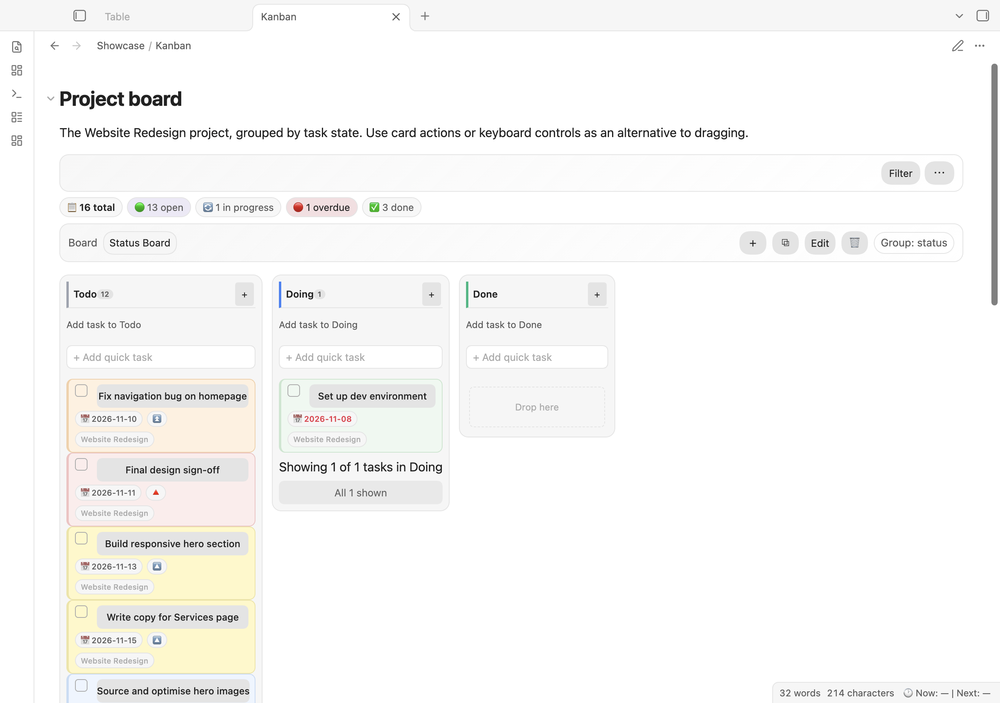

# Kanban and project workspaces

## Kanban view

Use a query block to display tasks as a Kanban board:

````markdown
```task-list
not done
view: kanban
group by status
```
````



Each column represents a group. Use the board's controls to work with tasks, or edit the source note directly. For other filters and grouping options, see the [query language reference](tutorials/QUERY_LANGUAGE.md).

To create a Markdown snapshot of all tasks grouped by status, run **Export all tasks as Kanban board**. It writes `Tasks Kanban - YYYY-MM-DD.md` at the vault root. Check for an existing file with that name before exporting; a new export can replace it. This snapshot is not a live view.

## Project workspaces

A project workspace is a Markdown note containing project information, queries, templates, and generated results.

1. Run **Create new project workspace** from the command palette.
2. Enter a name and folder. The default folder is `Projects`. Task Manager creates and opens `<name> Workspace.md`; it will not replace an existing workspace at that path.
3. Edit the workspace's queries, templates, and notes as needed.
4. With the workspace note open, run **Refresh current project workspace** to update its generated results.

Refresh replaces only the section between `<!-- task-manager-generated-views:start -->` and `<!-- task-manager-generated-views:end -->`. Keep your own notes outside those markers. Source task notes are read for the results but are not changed by the refresh. The generated results and timestamp are saved in the workspace note.
