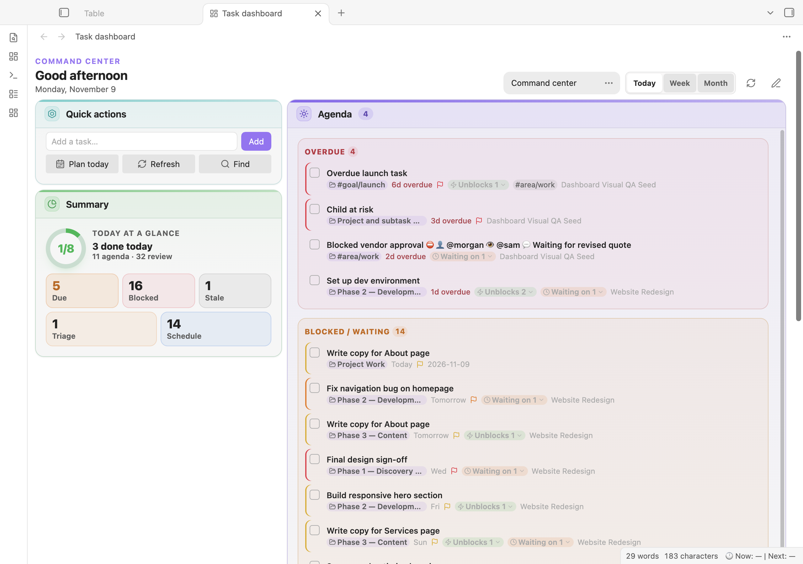
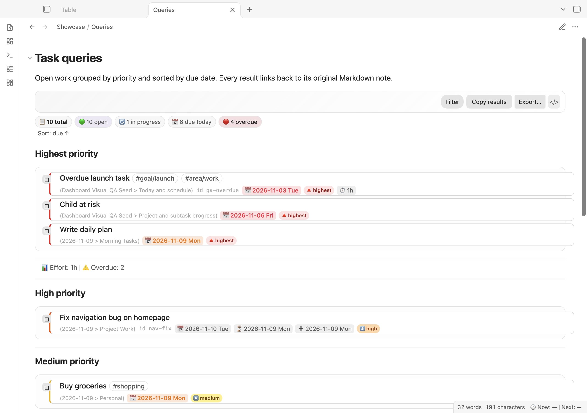
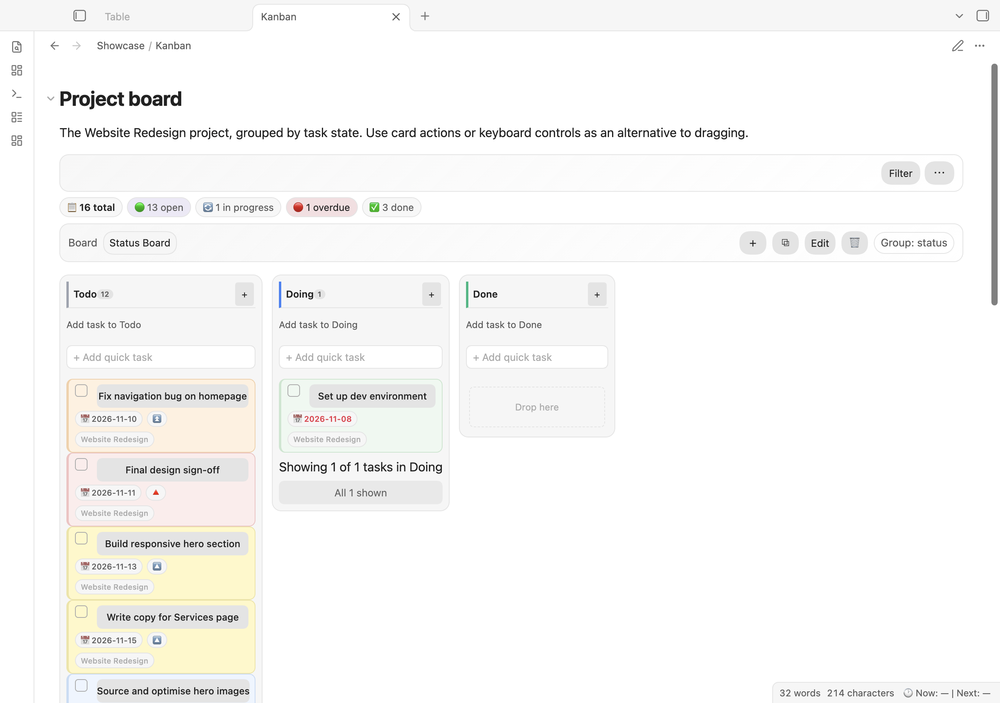
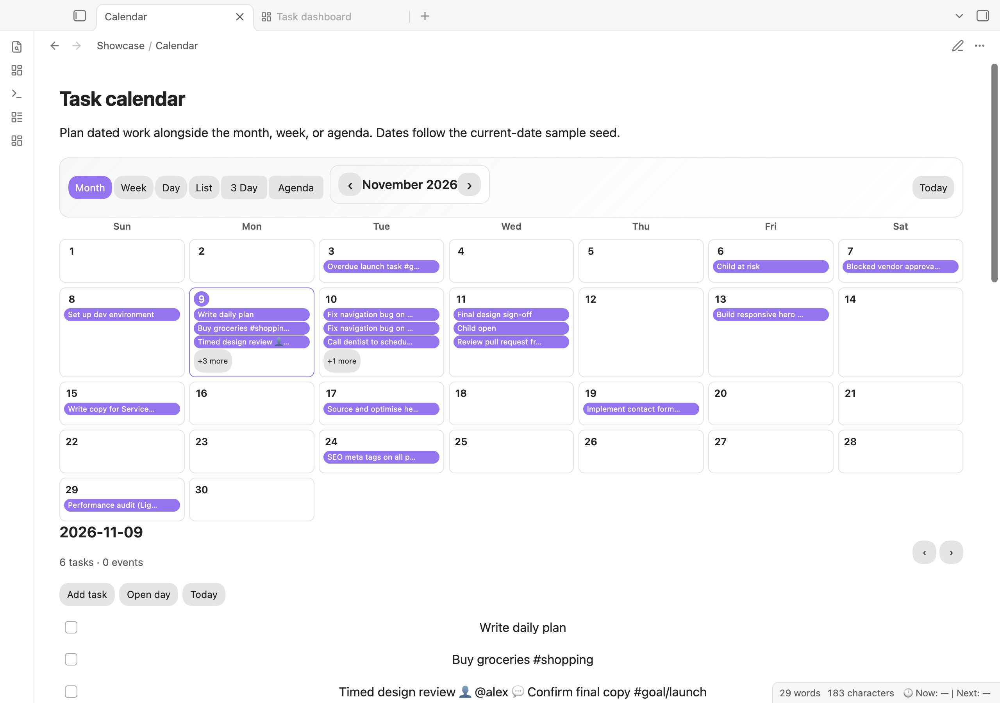
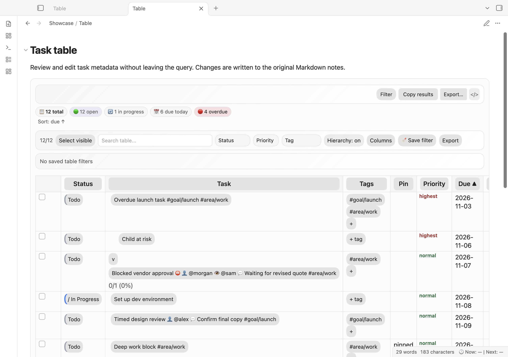
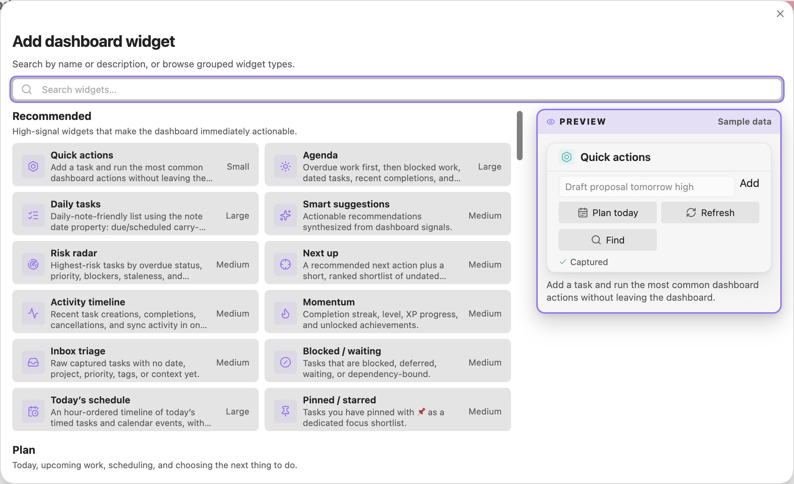

# Screenshots and visual assets

These **real Obsidian desktop captures** were made on **2026-11-09 local time** (UTC timestamps span November 9–10) using a disposable, current-date copy of the [sample vault](../../sample-vault/README.md). All 58 indexed tasks and the people/project names are synthetic. No personal vault was used.

The running host was Obsidian **1.15.0** (installer **1.15.0**) on macOS **27.2**, arm64. Only Task Manager **0.1.0** was enabled as a community plugin. Provider sync, AI, and reminder notifications remained disabled.

## Capture inventory

| Surface | PNG | CSS viewport | PNG pixels | Appearance |
| --- | --- | --- | --- | --- |
| Command center | [dashboard.png](dashboard.png) | 1280 × 900 | 2560 × 1800 | Default light |
| Command center | [dashboard-dark.png](dashboard-dark.png) | 1280 × 900 | 2560 × 1800 | Default dark |
| Responsive dashboard | [dashboard-narrow.png](dashboard-narrow.png) | 560 × 1000 | 1120 × 2000 | Default light; **desktop viewport, not mobile-device evidence** |
| Grouped query | [query-grouped.png](query-grouped.png) | 1280 × 900 | 2560 × 1800 | Default light |
| Project board | [kanban.png](kanban.png) | 1280 × 900 | 2560 × 1800 | Default light |
| Month calendar | [calendar.png](calendar.png) | 1280 × 900 | 2560 × 1800 | Default light |
| Metadata table | [table.png](table.png) | 1280 × 900 | 2560 × 1800 | Default light |
| Widget picker | [dashboard-widgets.png](dashboard-widgets.png) | 1280 × 900 | 2200 × 1344 | Default light; cropped to the real modal |

The dashboard uses **Native / Comfortable**, the default **Command center** layout, and its Quick actions, Summary, and Agenda widgets. Captures are viewport-sized; scrollable content continues outside the frame.

### Dashboard

[Matching dark theme](dashboard-dark.png) · [560px desktop viewport](dashboard-narrow.png)

### Queries and planning views

### Widget picker

