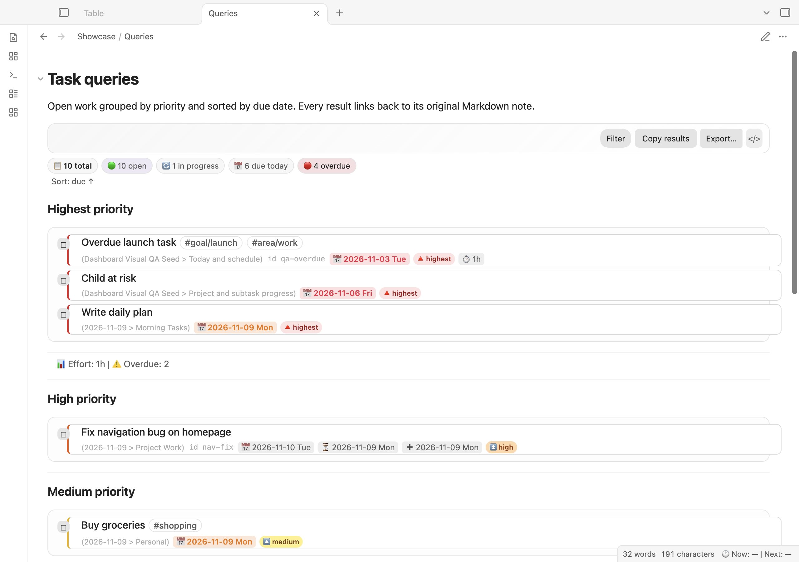

# Query Language Reference

Use Task Manager queries to filter, sort, group, and display tasks.



The example above uses the [sample vault](../../sample-vault/README.md).

## Syntax Overview

Basic structure:
```
[filter clauses]
[sort clause]
[group clause]
[layout/view options]
[limit]
```

## Filter Clauses

### Status Filters

```
done                              # Tasks marked done
not done                          # Tasks not done
status: in progress               # Specific status
status: [Done|Cancelled|Blocked]  # Pick one or more
is blocked                        # Currently blocked
is blocking                       # Blocks other tasks
```

### Date Filters

```
due today                         # Due on today's date
due tomorrow                      # Due tomorrow
due this week                     # Due within 7 days
due next week                     # Due in next 7 days
due this month                    # Due in current month
due 2026-Q2                       # Due in Q2 2026
due before 2026-06-15            # Before date
due on 2026-06-15                # On exact date
due on or after 2026-06-15       # On or after
due 2026-06-10 to 2026-06-20     # Date range

# Also: scheduled, start, created, done, cancelled, reminder
scheduled before today
start on 2026-05-20
created after 2026-01-01
reminder today
```

### Priority Filters

```
priority highest                 # Highest priority
priority high                    # High
priority medium                  # Medium (default)
priority low                     # Low
priority lowest                  # Lowest
priority is 🔺                   # By emoji/symbol
```

### Path & File Filters

```
path includes /projects          # File path contains text
path does not include /archive   # File path excludes
path regex ^2026-               # Regex on path
root: Finance                    # In folder (exact)
folder includes /Projects        # In any subfolder
filename includes draft          # Filename contains
heading includes To Do           # Under specific heading
```

### Tag Filters

```
tag includes #project            # Has tag
tag includes #review OR tag includes #waiting  # Multiple tags (OR)
tag does not include #done       # Doesn't have tag
tags: #bug #critical            # All of these
tag: #inbox                      # Named tag syntax
```

### Text Filters

```
description includes fix         # Task text contains
description does not include draft  # Task text excludes
description regex ^Fix:          # Regex on description
original markdown includes 📌    # Includes markdown emoji
```

### Dependency Filters

```
is blocked                       # Task is blocked by others
is blocking                      # Task blocks others
depends on task-id               # Specific dependency
dependency count > 2             # Multiple deps
no dependencies                  # No deps at all
```

### Recurrence Filters

```
recurring                        # Has recurrence
not recurring                    # One-time task
recurrence includes every day    # Specific pattern
recurrence does not include      # Exclude pattern
```

### Other Filters

```
exclude sub-items                # Skip subtasks
has id                          # Has a task ID
id: my-task                     # Specific ID
no id                           # No ID set
has created date                # Created date exists
no created date                 # No created date
has effort                      # Effort estimate set
effort > 2h                     # Effort comparisons
```

### Advanced: Function Expressions

*(Requires both **Enable advanced query DSL** and **Enable function expressions in queries**. See [Query security boundaries](../QUERY_SECURITY.md).)*

```
filter by function task.priorityNumber < 3
filter by function task.due && task.due < today()
filter by function task.description.length > 20
filter by function task.tags.includes("urgent")
```

Available properties: `task.description`, `task.priority`, `task.due`, `task.scheduled`, `task.file.path`, `task.isRecurring`, `task.isDone`, `task.effort`, etc.

### Boolean Composition

Combine filters with logic:

```
(priority highest OR priority high) AND not done
done AND created this month
(path includes /projects) AND (not done) AND (priority high)
NOT tag #archive
(due before tomorrow) OR (is blocked)
```

Operators: `AND`, `OR`, `NOT`, parentheses for grouping.

## Sorting

### Basic Sorts

```
sort by smart                    # Urgency-based (default)
sort by urgency                  # Same as smart
sort by status                   # By current state
sort by priority                 # By priority value
sort by due                      # By due date
sort by scheduled                # By scheduled date
sort by start                    # By start date
sort by created                  # By creation date
sort by done                     # By done date
sort by effort                   # By time estimate
sort by description              # Alphabetically
sort by path                     # By file path
sort by random                   # Randomize
sort by recurrence               # By pattern
sort by tag                      # By tags
sort by id                       # By task ID
sort by original markdown        # Original order
sort by line number              # Source line
```

### Reverse Sort

```
sort by due reverse              # Latest due first
sort by priority reverse         # Lowest priority first
```

### Multi-Field Sort

```
sort by status due               # Primary: status, secondary: due
sort by priority, due reverse     # Reverses both priority and due criteria
```

Multi-field sorts use whitespace- or comma-separated field names. One trailing `reverse` applies to every field on that line. Mixed per-field directions and `then by` syntax are not supported.

### Function Sort

```
sort by function task.priorityNumber - task.daysUntilDue()
sort by function task.effort || Infinity  # NaN-safe
```

## Grouping

### Basic Groups

```
group by status                  # Group by status (Todo, Done, etc.)
group by priority                # High, Medium, Low
group by due                     # Group by due date
group by created                 # By creation date
group by path                    # By file path
group by tag                     # By tags (multiple groups)
group by folder                  # By folder name
group by is blocked              # Blocked vs not blocked
```

### Group Options

```
group by status limit 3          # Max 3 items per group
group by due reverse             # Reverse order
group by path limit 5 reverse    # Combined options

group by status
  group by priority              # Nested grouping: 2 levels
```

### Function Grouping

```
group by function task.priorityNumber  # Numeric groups
group by function task.due?.format('MMMM')  # By month name
```

## Layout Controls

### Field Visibility

```
show task count                  # Show total count
hide task count                  # Hide count
show urgency                     # Show urgency score
hide due date                    # Hide due dates in results
hide priority                    # Hide priority
hide effort                      # Hide time estimates
hide created date                # Hide creation dates
show tree                        # Show nested structure
hide tree                        # Flatten results
show toolbar                     # Show filter/export buttons
hide toolbar                     # Minimal UI
show edit button                 # Edit button on each row
hide edit button                 # No edit button
show postpone button             # Postpone menu
hide postpone button             # No postpone
```

### Other Layout

```
limit 20                         # Show max 20 tasks
limit groups 5                   # Max 5 per group
# Explicit limits are capped at 1,000; row-heavy results page 100 rows at a time.
css-class: my-custom-style       # Add CSS class
explain                          # Show debug info
```

## View Modes

Choose visualization:

```
view: list                       # Styled Task Manager list rows (default)
view: checklist                  # Plain native-looking checklist rows
style: checklist                 # Alias for view: checklist
view: table                      # Table with columns
view: grid                       # Grid (alias for table)
view: kanban                     # Kanban board by status
view: calendar                   # Month calendar
view: gantt                      # Timeline (start to due)
view: stats                      # Completion statistics
view: graph                      # Dependency graph
view: eisenhower                 # Priority/urgency matrix
view: timeline                   # Hourly time-blocking
```

Each query block selects exactly one view. To present multiple visualizations, create a separate `task-list` block for each view; pipe-separated view lists are not supported.

### Kanban-Specific

```
view: kanban
wip limit 5                      # Work-in-progress limit
```

## Query Macros

### Presets

```
preset: Open Tasks               # Insert saved query preset
{{preset.Open Tasks}}            # Template syntax
```

### File Placeholders

```
{{query.file.path}}              # Current file path
{{query.file.name}}              # Filename
{{query.file.folder}}            # Folder
{{query.file.mtime}}             # Modified time
```

### Inline Comments

```
{{! This comment is ignored in rendering}}
{{! Group all tasks by the file they're in }}
group by path
```

## Example Queries

### Daily Dashboard

```task-list
not done
sort by smart
group by status
```

### High-Priority This Week

```task-list
priority high OR priority highest
due before 2026-06-04
not done
sort by due
```

### Kanban Board

```task-list
view: kanban
not done
group by status
```

### Project Roadmap

```task-list
path includes /projects
sort by priority due
group by path
view: gantt
```

### Overdue Tasks

```task-list
not done
due before today
view: table
hide tree
sort by due reverse
```

### By Effort

```task-list
not done
has effort
group by effort
sort by due
show effort
```

### With Dependencies

```task-list
is blocked
sort by priority
view: graph
```

### Eisenhower Matrix

```task-list
view: eisenhower
not done
```

## Performance Tips

1. **Use specific paths** — `path includes /work` restricts results to matching paths
2. **Limit results** — `limit 100` reduces rendering time
3. **Use the safe regex subset** — Task queries reject `v` mode, backreferences, lookarounds, multiple variable quantifiers or alternations, and ambiguous repeated groups before matching. Prefer one simple character-class/literal quantifier.
4. **Cache queries** — Queries run on file change; results are cached
5. **Pagination** — Use multiple small queries instead of one huge query

## Debugging

Add `explain` to see why tasks matched/didn't match:

```task-list
not done
priority highest
explain
```

Shows:
- Filter results for each task
- Sort scores
- Errors (invalid dates, bad regex, etc.)

## Operators Reference

| Symbol | Meaning |
|--------|---------|
| `&&` or `AND` | Logical AND |
| `\|\|` or `OR` | Logical OR |
| `!` or `NOT` | Logical NOT |
| `()` | Grouping |
| `>`, `<`, `>=`, `<=`, `==`, `!=` | Comparisons (function expressions) |

## Error Messages

| Error | Fix |
|-------|-----|
| "Unknown filter: X" | Check spelling of filter name |
| "Invalid date format" | Use YYYY-MM-DD format |
| "Regex error" | Check syntax and simplify to the supported safe subset (no `v`, backreferences, lookarounds, multiple variable quantifiers or alternations, or ambiguous repeated groups) |
| "Function expressions disabled" | Enable in settings |
| "Unknown status: X" | Use configured status names |

---

For an introduction, see [Getting started](GETTING_STARTED.md).
